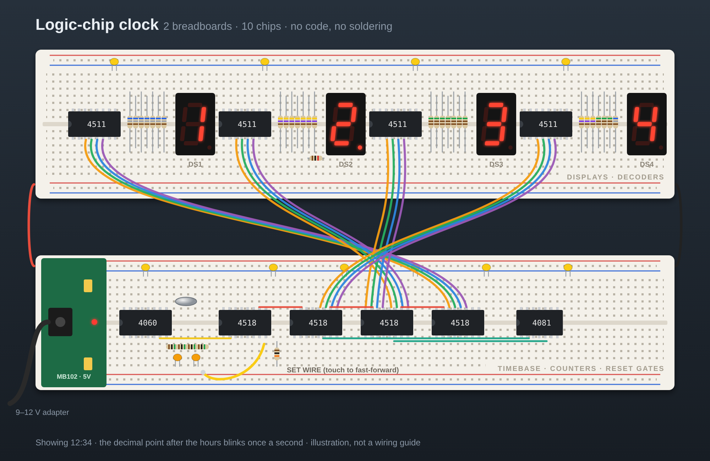
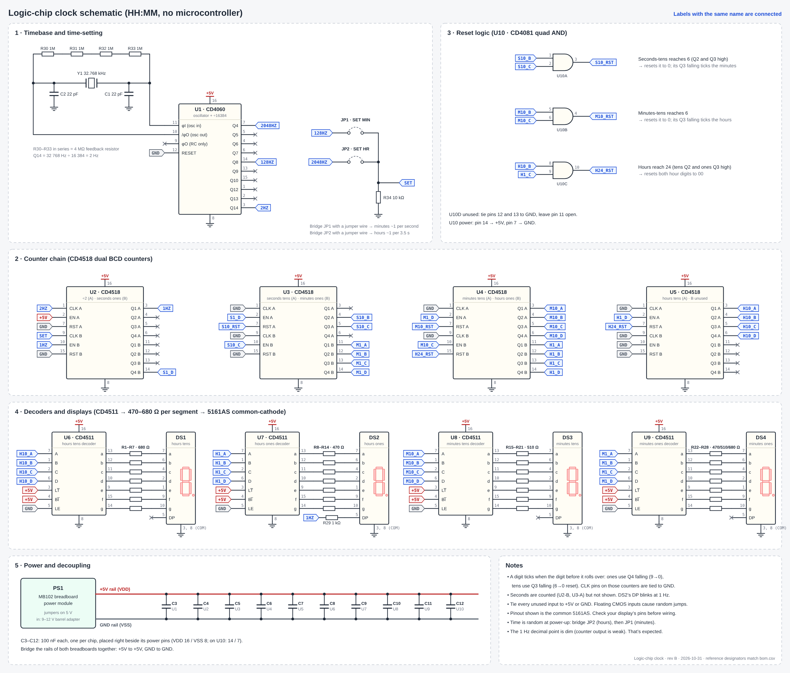

# Logic-Chip Clock

A 24-hour clock with 4 digits (HH:MM), assembled entirely from 4000-series CMOS logic chips across two breadboards. There is no microcontroller, no code, and no soldering. All of the timekeeping is handled by chips that you wire together yourself.

The total cost comes to about **$28** for parts from AliExpress, tax and shipping included.

## Contents of this repo

| Path | Description |
|---|---|
| `schematic/logic-clock.kicad_pro` + `.kicad_sch` | KiCad schematic (KiCad 7 format, opens in versions 8 and 9) |
| `schematic/logic-clock-schematic.pdf` | The same schematic in PDF form |
| `docs/clock-schematic.png` / `.svg` | Single-page overview drawing showing pin numbers |
| `docs/logic-clock.png` | Illustration of the completed build |
| `bom.csv` | Bill of materials with links and prices |

## How it works

**1. Timebase.** A 32.768 kHz watch crystal oscillates together with the inverter inside a CD4060 (U1). The CD4060 also serves as a 14-stage divider, so its Q14 output (pin 3) comes out at 32,768 ÷ 16,384 = **2 Hz**.

**2. Divide by 2.** One half of a CD4518 (U2-A) counts the 2 Hz pulses. On every count its lowest bit (Q1) toggles, producing a clean **1 Hz** tick.

**3. Counting.** Six decimal counters are arranged in a chain, using the other half of U2 and three additional CD4518 chips:

| Counter | Digit |
|---|---|
| U2-B | seconds ones |
| U3-A | seconds tens |
| U3-B | minutes ones |
| U4-A | minutes tens |
| U4-B | hours ones |
| U5-A | hours tens |

Whenever the digit before a counter rolls over, that counter advances. Ones digits count from 0 to 9 by themselves, and when their top bit (Q4) falls at the 9→0 transition, it ticks the next digit. Seconds are counted but not displayed.

**4. Resets.** A tens-of-seconds or tens-of-minutes counter would count past 5 without complaint, so an AND gate (CD4081, U10) watches for 6 (`0110`: Q2 and Q3 both high) and resets it to 0 immediately. That reset causes its Q3 to fall, which ticks the next digit. A third AND gate watches for hours = 24 (tens Q2 and ones Q3 high) and resets both hour digits to 00.

**5. Display.** The 4-bit count for each digit is fed into a CD4511 decoder (U6–U9), which drives the appropriate segments of a common-cathode 7-segment display, using one resistor per segment. The decimal point on the ones digit of the hours blinks at 1 Hz to indicate seconds.

**6. Setting the time.** No buttons are provided. To set the time, use a spare jumper wire to bridge one of the two gaps (JP1, JP2). This sends a fast signal to the SET node (U2 pin 9):

| Gap | Connects | Effect |
|---|---|---|
| JP2 | 2048 Hz (U1 pin 7) to SET | hours advance roughly once every 3.5 s |
| JP1 | 128 Hz (U1 pin 14) to SET | minutes advance roughly once per second |

At all other times, a 10k resistor (R34) keeps SET low.

**7. Power.** A 9–12 V wall adapter is converted into a 5 V rail by an MB102 breadboard power module.

## Bill of materials

Prices are from the AliExpress US checkout as of Nov 1, 2026. Every item is shipped by AliExpress itself (the "Choice" program), so once that portion of the order exceeds $10, shipping is free. Complete details and the exact variant to select can be found in [`bom.csv`](bom.csv).

| Ref | Part | Qty used | Price |
|---|---|---|---|
| U1 | [CD4060BE (pack of 10)](https://www.aliexpress.us/item/3256803148137606.html) | 1 | $1.76 |
| U2–U5 | [CD4518BE (5-pack)](https://www.aliexpress.us/item/3256812407957703.html) | 4 | $1.98 |
| U6–U9 | [CD4511BE (5-pack)](https://www.aliexpress.us/item/3256812407656068.html) | 4 | $1.68 |
| U10 | [CD4081BE (5-pack)](https://www.aliexpress.us/item/3256812908266140.html) | 1 | $1.88 |
| DS1–DS4 | [0.56" red 7-segment, **common cathode** (5-pack)](https://www.aliexpress.us/item/3256810377855693.html) | 4 | $1.09* |
| Y1 | [32.768 kHz crystal (20-pack)](https://www.aliexpress.us/item/2251800614977910.html) | 1 | $1.63 |
| BB1, PS1, W1 | [830 breadboard + MB102 power module + 65 jumper wires](https://www.aliexpress.us/item/3256805886191982.html) | 1 kit | $4.95 |
| BB2 | [Second 830 breadboard](https://www.aliexpress.us/item/3256805886191982.html) | 1 | $3.25 |
| R1–R34 | [Resistor kit, 30 values × 10](https://www.aliexpress.us/item/3256811586219421.html) | 34 | $3.45 |
| C1–C2 | [22 pF ceramic (50-pack)](https://www.aliexpress.us/item/3256808410076521.html) | 2 | $2.10 |
| C3–C12 | [100 nF ceramic (50-pack)](https://www.aliexpress.us/item/3256808410076521.html) | 10 | $2.09 |
| JP1–JP2 | One spare jumper wire taken from the kit | — | — |
| — | 9–12 V wall adapter, 5.5×2.1 mm plug | 1 | (already owned) |
| | **Parts subtotal** | | **$25.86** |
| | **Tax (at checkout)** | | **$2.52** |
| | **Total** | | **$28.38** |

\* Discounted price for returning shoppers. Regular price is $1.98.

**Resistors taken from the kit:**

| Ref | Value | Use |
|---|---|---|
| R1–R7 | 680Ω | DS1 segments (hours tens) |
| R8–R14 | 470Ω | DS2 segments (hours ones) |
| R15–R21 | 510Ω | DS3 segments (minutes tens) |
| R22–R24 | 470Ω | DS4 segments a–c (minutes ones) |
| R25–R27 | 510Ω | DS4 segments d–f |
| R28 | 680Ω | DS4 segment g |
| R29 | 1kΩ | DS2 decimal point |
| R30–R33 | 1MΩ ×4, in series | oscillator feedback |
| R34 | 10kΩ | SET pull-down |

## Assembly

No soldering is required. Flush cutters and a multimeter are helpful, but you don't need them.

### Before you start
- CMOS chips are susceptible to static. Before you handle them, touch something grounded, and avoid touching the pins.
- Place each chip across the center channel with its notch oriented the same way (left).
- Test each display before proceeding. Connect pin 3 or 8 to GND, then touch 5 V to pin 7 through a 1k resistor. Segment **a** should illuminate. If nothing lights up, your display may be common-anode, which won't work here.
- Keep everything unplugged while you wire.

### 1. Power and layout
1. Attach the MB102 module to the end of **board 2** and set both of its jumpers to **5V**.
2. Connect the rails of the two boards together: +5V to +5V and GND to GND, at both the top and the bottom.
3. Connect the adapter and use a multimeter to verify 5 V on the rails. After that, disconnect it.
4. Arrange the layout as follows:
   - **Board 1:** the four displays alongside their CD4511 decoders.
   - **Board 2:** CD4060, four CD4518, CD4081.
5. Place a 100 nF capacitor (C3–C12) across the power pins of every chip:
   - CD4060, CD4518 and CD4511: pin 16 (+5V) and pin 8 (GND)
   - CD4081: pin 14 (+5V) and pin 7 (GND)

### 2. Timebase (U1, CD4060)
| Pin | Connect to |
|---|---|
| 16 | +5V |
| 8 | GND |
| 12 (reset) | GND |
| 10 and 11 | crystal Y1, connected between these two pins |
| 10 and 11 | R30–R33 (4 × 1MΩ) in series, connected between these two pins |
| 11 | C1 (22 pF) to GND |
| 10 | C2 (22 pF) to GND |

**Test:** connect pin 3 via 1k to the decimal point of the spare 5th display (with its pins 3 and 8 to GND). It should blink twice per second.

### 3. Divide-by-2 and seconds ones (U2, CD4518)
| Pin | Connect to |
|---|---|
| 16 | +5V |
| 8 | GND |
| 1 | U1 pin 3 (2 Hz) |
| 2 | +5V |
| 7 | GND |
| 10 | U2 pin 3 (1 Hz) |
| 9 | SET node: R34 (10k) to GND |
| 15 | GND |

**Test:** shift the decimal point of the spare display to U2 pin 3. It ought to blink once per second.

### 4. Seconds tens and minutes ones (U3, CD4518)
| Pin | Connect to |
|---|---|
| 16 | +5V |
| 8 | GND |
| 1, 9, 15 | GND |
| 2 | U2 pin 14 |
| 10 | U3 pin 5 |
| 7 | U10 pin 3 |

Wire up the reset gate: connect U10 pin 1 to U3 pin 4 and U10 pin 2 to U3 pin 5. Supply U10 with power via pin 14 (+5V) and pin 7 (GND).

### 5. Minutes tens and hours ones (U4, CD4518)
| Pin | Connect to |
|---|---|
| 16 | +5V |
| 8 | GND |
| 1, 9 | GND |
| 2 | U3 pin 14 |
| 10 | U4 pin 5 |
| 7 | U10 pin 4 |
| 15 | U10 pin 10 |

Connect the reset gate as follows: U10 pin 5 goes to U4 pin 4, and U10 pin 6 goes to U4 pin 5.

### 6. Tens of hours (U5, CD4518)
| Pin | Connect to |
|---|---|
| 16 | +5V |
| 8 | GND |
| 2 | U4 pin 14 |
| 7 | U10 pin 10 |
| 1, 9, 10, 15 | GND |

Connect the 24-hour gate as follows: U10 pin 8 goes to U5 pin 4, and U10 pin 9 goes to U4 pin 13.

Terminate the unused gate: connect U10 pins 12 and 13 to GND, and leave pin 11 unconnected.

### 7. Decoders and displays (board 1)
Connect each CD4511 in the same manner:

| Pin | Connect to |
|---|---|
| 16 | +5V |
| 8 | GND |
| 3 (LT) | +5V |
| 4 (BI) | +5V |
| 5 (LE) | GND |

The inputs **A (pin 7), B (pin 1), C (pin 2), D (pin 6)** are supplied by the counter's Q1, Q2, Q3, Q4:

| Display | Decoder | Counter pins → A, B, C, D | Segment resistors |
|---|---|---|---|
| DS1 hours tens | U6 | U5 pins 3, 4, 5, 6 | R1–R7 |
| DS2 hours ones | U7 | U4 pins 11, 12, 13, 14 | R8–R14 |
| DS3 minutes tens | U8 | U4 pins 3, 4, 5, 6 | R15–R21 |
| DS4 minutes ones | U9 | U3 pins 11, 12, 13, 14 | R22–R28 |

Every decoder output is routed through its resistor to the corresponding display pin:

| Segment | a | b | c | d | e | f | g |
|---|---|---|---|---|---|---|---|
| CD4511 pin | 13 | 12 | 11 | 10 | 9 | 15 | 14 |
| Display pin | 7 | 6 | 4 | 2 | 1 | 9 | 10 |

- Display pins 3 and 8 are connected to GND.
- The decimal point of DS2 (pin 5) is wired through R29 (1k) to U2 pin 3, causing it to blink once per second.

### 8. Turn on the power and set the time
1. Connect it to power. A random time will appear on the digits.
2. Use a jumper wire to bridge **JP2** (U1 pin 7 to U2 pin 9) until the hours are correct.
3. Use a jumper wire to bridge **JP1** (U1 pin 14 to U2 pin 9) until the minutes are correct.

## Troubleshooting

| Symptom | Check |
|---|---|
| Nothing counts | Is U1 pin 3 showing 2 Hz? Inspect Y1, the R30–R33 chain, and C1/C2. |
| A digit is blank or displays garbage | The display may be common anode. Also verify LT/BI at +5V and LE at GND. |
| Tens digit exceeds 5 | The wiring of that digit's AND gate. |
| Hours exceed 23 | The 24-hour gate (U10 pins 8, 9, 10). |
| Random jumps | A missing 100 nF cap, an unused input left floating, or a loose breadboard connection. |
| The decimal point is dim | This is expected. The counter output is only able to provide a small amount of current. |
| One digit appears slightly dimmer | This is expected. The digits are driven through 470, 510 and 680Ω resistors. |

## Notes
- The display pinout shown corresponds to the common 5161AS. Inexpensive clones can differ, so verify the one you have.
- Accuracy is determined by the crystal and its load capacitors. You can expect a few seconds of drift each day.
